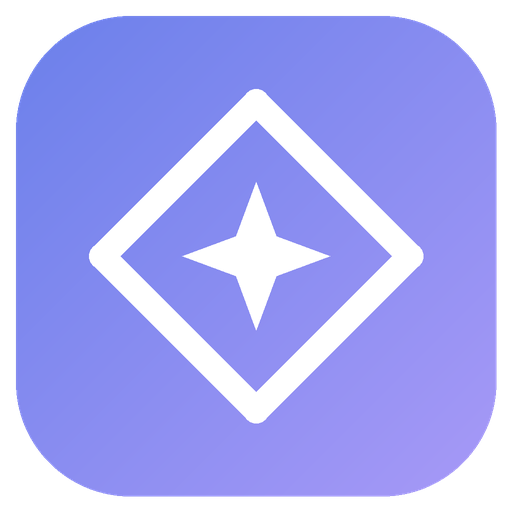
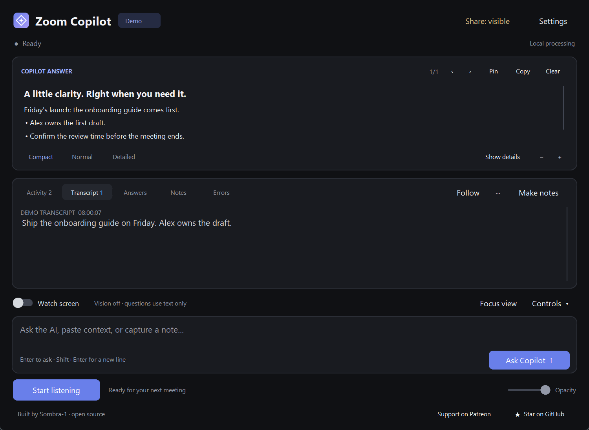
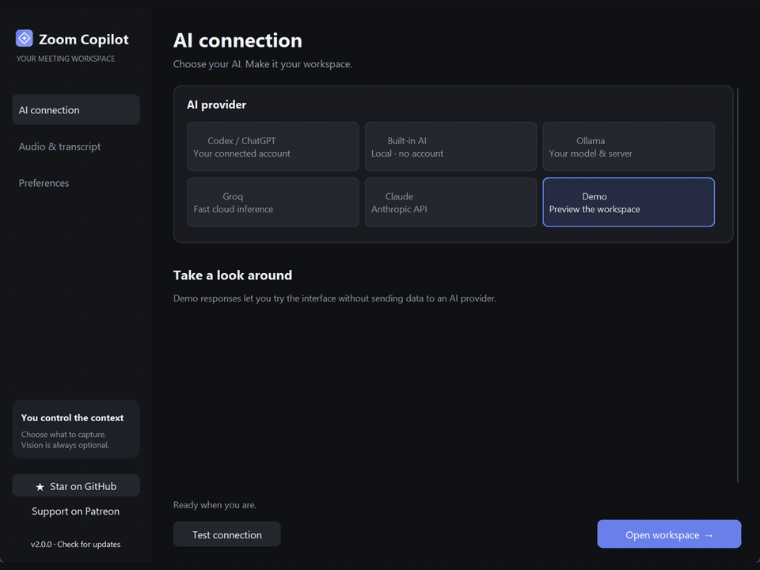
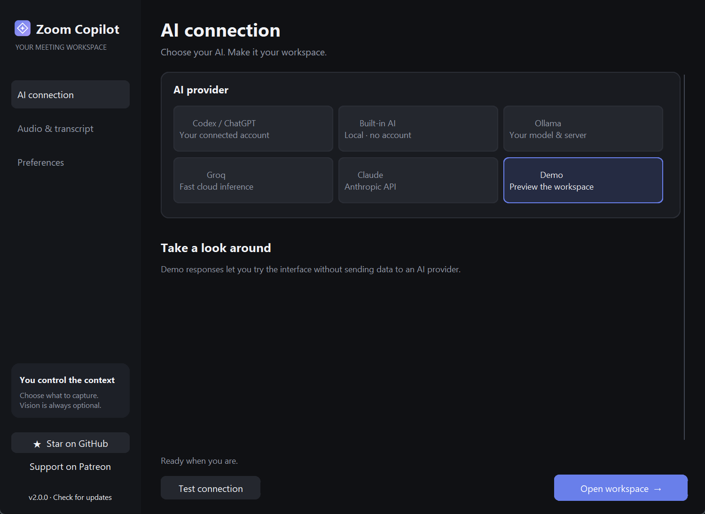
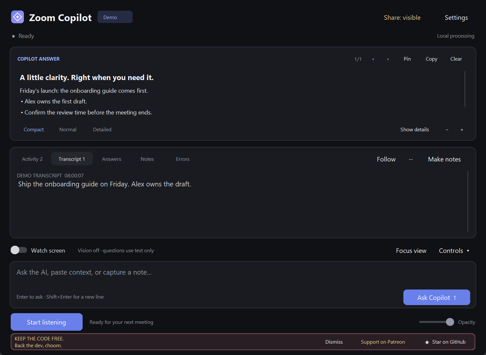

<p align="center"></p>
<h1 align="center">Zoom Copilot</h1>
<p align="center">A little clarity. Right when you need it.<br>Live transcripts, useful answers, and meeting notes in one desktop workspace.</p>
<p align="center">
  <a href="https://github.com/Sombra-1/zoom-copilot/releases/latest">Download the latest release</a> ·
  <a href="https://www.patreon.com/cw/Sombra551/membership">Support on Patreon</a> ·
  <a href="https://github.com/Sombra-1/zoom-copilot/stargazers">Star the project</a>
</p>

[](https://github.com/Sombra-1/zoom-copilot/actions/workflows/ci.yml)
[](https://github.com/Sombra-1/zoom-copilot/releases/latest)

[](LICENSE)



## What's new in 2.0

- A redesigned dark workspace, clear provider setup, a compact layout, and a resizable answer panel.
- Codex / ChatGPT integration through the official CLI, with account status, model discovery, and cancellable text/image requests.
- **Watch screen**: turn it on once for fresh screen context when you ask questions. Choose a window, region, primary screen, or all displays.
- A branded Windows launcher, taskbar icon, desktop shortcut, and tray icon. Normal launch opens without a CMD window.
- **Support on Patreon** and **Star on GitHub** buttons. A small cyberpunk-inspired invitation appears once after three hours of use.
- Background update notices with installed/latest versions, a release link, and dismissal for that version. Manual checking is available in Settings.
- Fixes for startup failures, stale workers after restart, ordered audio processing, capture fallback, and shutdown.

## See it in action



[Watch or download the MP4 demo](https://github.com/Sombra-1/zoom-copilot/raw/refs/heads/main/docs/media/demo.mp4).
All screenshots and demo footage use synthetic content in Demo mode. No meeting audio or personal screen content is included. The support invitation is accelerated for the recording.

<details>
<summary>Provider setup and support invitation</summary>




</details>

## Start on Windows

1. Download **Zoom-Copilot-v2.0.2.zip** from the [latest release](https://github.com/Sombra-1/zoom-copilot/releases/latest) and extract the entire folder.
2. Run **setup.bat**. It checks Python 3.11+, creates a virtual environment, installs dependencies, and creates your desktop shortcut. Driver installation may request administrator access.
3. Open **Zoom Co-Pilot** from your Desktop, or **Zoom Copilot.exe** in the extracted folder.
4. Choose an AI provider. **Demo** lets you explore the interface immediately without an account. Configure audio when you want transcription, then select **Open workspace**.

The EXE is a small windowless launcher, not a bundled Python runtime. Keep it with the app files and run setup first. Editable icon and launcher sources are included; see [APP_ICON.md](APP_ICON.md).

For meeting audio, select **CABLE Input** as Zoom/Teams/Meet's speaker and the matching **CABLE Output** capture device in Copilot. Use VB-Cable's monitoring settings if you also need to hear that output. Typed questions work without audio setup.

For an existing installation, close the app and update the source files, then rerun **setup.bat** to refresh dependencies. Keep your local `.copilot_settings.json` if you want to retain configuration. Do not upload it to GitHub.

## Your workspace

| Control | What it does |
| --- | --- |
| Start listening | Transcribes your selected input into meeting context. |
| Ask Copilot | Answers typed questions using the current context. |
| Watch screen | Enables periodic screen context; new workspaces always start with vision Off. |
| Controls | Chooses a region, application window, primary screen, or all displays. |
| Make notes | Creates summaries, decisions, action items, and open questions from the transcript. |
| Answer panel | Shows formatted answers, local LaTeX and highlighted code, with history, pinning and copy. |
| Activity filters | Switches between transcript, answers, notes, and errors. |
| More menu (···) | Exports Markdown notes or session text. |
| Settings → version button | Checks GitHub for a newer stable release. |

Screen watch uses sampled images rather than a continuous video stream. Typed and triggered spoken questions attach a fresh image while vision is enabled. **Ctrl+Shift+S** toggles whole-screen watching while Copilot is focused. Cloud vision sends the selected images to your chosen provider; local options depend on model capability.

## Choose your AI

| Provider | What you need |
| --- | --- |
| Codex / ChatGPT | Official Codex CLI installed and signed in; model access depends on your account. [Setup and details](CODEX.md). |
| Ollama | Ollama and a compatible local model; local processing is available. |
| Groq | Your Groq API key and an internet connection. |
| Claude | Your Anthropic API key and an internet connection. |
| Demo | No account or provider request; synthetic replies for exploring the UI. |

Transcription is separate: choose **Groq Whisper** with your own Groq key, or install **Local Whisper** from **Audio & transcript**. Local Whisper needs an initial model download, then can transcribe offline. Provider pricing, access and limits vary.

## Privacy and reliability

- Vision starts **Off** every time you open a workspace. Scope and cloud/local status stay visible.
- Codex uses its own managed sign-in. Copilot does not read or copy Codex credential files, and meeting requests do not receive shell, filesystem, or desktop tools.
- Keys and app configuration stay in your local `.copilot_settings.json`. Treat that file as a secret.
- Transcription uses its own ordered queue, so a slow spoken answer does not stall it. The footer shows queued audio and gap counts. Detected losses appear between the surrounding speech in the transcript and Markdown export.
- **Stop listening** closes the input stream and finishes captured audio, including the last partial chunk, through the selected transcription provider. Wait for **Finishing audio…** to clear before generating notes or exporting.
- The spoken answer worker keeps the newest pending prompt when it falls behind. The transcript keeps decoded chunks from the active session. Generation guards prevent stopped workers from writing into a later session.
- **Make notes** processes the available transcript in batches and carries earlier notes forward. Long meetings may take several requests to your selected provider.
- Notes are prompted to use captured context and acknowledge missing information. Review AI-generated notes before relying on them.
- Windows capture exclusion is requested and checked where supported. Capture behavior depends on the recording/sharing path; test your actual meeting app before relying on it. See [capture details](CODEX.md#vision-and-privacy).
- Startup/UI failures produce bounded local diagnostic metadata without exception messages, source lines, credentials, screenshots, or conversation content.
- The updater makes a public request to GitHub at most once per day automatically. It sends an app version in the User-Agent; GitHub receives normal connection metadata. It sends no meeting data or account token and never installs anything automatically. Offline failure leaves the app usable.
- Support usage is counted locally. It is never uploaded. [Support and update behavior](SUPPORT_FEATURES.md).

Use meeting capture with participants' permission and follow your organization's rules. Practice Assist is for mock interviews, accessibility, and situations where assistance is explicitly permitted.

## Support the developer

**KEEP THE CODE FREE. Back the dev, choom.**

If Copilot helps you, [support Sombra on Patreon](https://www.patreon.com/cw/Sombra551/membership) or [give the repository a star](https://github.com/Sombra-1/zoom-copilot). Patreon is an optional recurring membership; all app features remain free and open source. GitHub handles sign-in and star confirmation in your browser. Copilot never claims a payment or star was completed.

The in-app invitation appears once after three accumulated hours in the workspace. It has a Dismiss button and does not interrupt meetings or open a browser automatically.

## Development

Windows is the primary supported platform. Linux support is partial and requires an interactive desktop, Tk, and working PortAudio; the Windows launcher and capture exclusion do not apply there.

```powershell
python -m venv venv
venv/Scripts/python -m pip install -r requirements.txt -r requirements-optional.txt -r requirements-dev.txt
venv/Scripts/python zoom_copilot.py
```

On Linux, use `venv/bin/python` instead. You can also run `python setup.py` for the dependency checker. Equation rendering optionally uses Playwright Chromium (`python -m playwright install chromium`); missing optional tools leave text answers usable.

```powershell
python -m compileall -q zoom_copilot.py setup.py copilot_core tests tools
python -m tabnanny zoom_copilot.py setup.py copilot_core tests tools
python -m pyflakes zoom_copilot.py setup.py launch.pyw copilot_core tests tools
python -m unittest discover -v
python -m bandit -q -lll -r zoom_copilot.py setup.py copilot_core
```

CI runs the regression suite on Windows with Python 3.11, 3.12 and 3.13, plus a high-severity Bandit check. Native capture and offline rendering tests are opt-in on a configured interactive desktop. See [release validation](RELEASE_CHECKS.md) for results and practical limits. [Logo/launcher rebuild](APP_ICON.md) · [Codex implementation](CODEX.md).

## Troubleshooting

- **Codex CLI not found:** leave the CLI path blank for automatic discovery, or select the native CLI executable. Do not select the desktop GUI. See [Windows discovery](CODEX.md#cli-detection-on-windows).
- **No audio:** verify the meeting speaker, virtual cable and selected input device. A microphone only records its own input.
- **Provider error:** check the visible API-key field, model selection and provider account access. Local Whisper and Ollama offer local alternatives.
- **Window closes during launch:** use `setup.bat` to check dependencies. Startup errors show a dialog; local diagnostics are in `%LOCALAPPDATA%\ZoomCopilot\logs\runtime.log`.
- **Update check says offline:** try the Settings version button later, or open [Releases](https://github.com/Sombra-1/zoom-copilot/releases/latest) directly.
- **CMD flashes:** open the EXE or Desktop shortcut. Batch files can briefly show a console.

## License

Copyright (C) 2026 Sombra-1. Released under [GNU GPL v3](LICENSE).
Keep the copyright and license notices, and distribute modifications under the same license. Bundled renderer assets retain their own notices in `copilot_core/vendor`.
